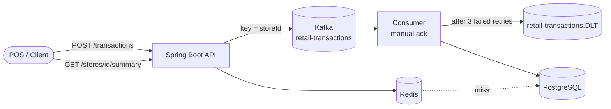

# Event Stream Retail Pipeline

A small event-driven pipeline for retail transactions, built with Java 21, Spring Boot 3, Kafka, PostgreSQL and Redis.

I put this together as a reference project for the kind of backend work I do day to day: transactions come in over a REST API, get published to Kafka, and a consumer persists them and keeps per-store daily totals up to date. The interesting parts aren't the endpoints — they're the delivery semantics: duplicate deliveries, retries, dead letters, and making sure the numbers stay right anyway.

— Arshad Ansari, Senior Java Backend Engineer

## How it fits together



- `POST /api/v1/transactions` validates the payload and publishes an event. It returns **202**, because at that point the transaction is queued, not yet stored.
- The consumer processes events and writes them to PostgreSQL. Offsets are acked manually, only after processing succeeds.
- `GET /api/v1/stores/{storeId}/summary?date=2026-11-25` returns the day's count, total amount and item count for a store, served from a Redis cache.

## Decisions worth explaining

**Idempotency.** Kafka gives at-least-once delivery, so any record can show up twice (rebalance, crash before the offset commit, producer retry). I keep a `processed_events` table keyed by transaction id. The consumer checks it first; the transaction row and the ledger row are written in the same database transaction, so a redelivery is detected and skipped. That's what keeps the daily totals correct.

**Retries and the dead-letter topic.** A record that keeps failing shouldn't block its partition forever. The error handler retries 3 times with a 1-second pause, then publishes the record to `retail-transactions.DLT` where it can be looked at later.

**Partitioning.** Events are keyed by `storeId`, so everything for one store goes to one partition and is consumed in order. The producer runs with `acks=all` and idempotence on.

**Caching.** Daily summaries are read much more often than they change, so they're cached in Redis with a 10-minute TTL. When the consumer stores a transaction, it evicts that store's summary for the day — the TTL is just a safety net.

**Schema.** Flyway owns the schema (`V1__init.sql`); Hibernate only validates against it.

## Run it

You need JDK 21, Maven and Docker.

```bash
docker compose up -d        # Kafka (KRaft, no Zookeeper), PostgreSQL, Redis
mvn spring-boot:run
```

Then:

```bash
curl -X POST http://localhost:8080/api/v1/transactions \
  -H 'Content-Type: application/json' \
  -d '{"transactionId":"TX-1","storeId":"STORE-42","amount":499.99,
       "currency":"INR","paymentMethod":"CARD","itemCount":2,
       "occurredAt":"2026-11-25T09:30:00Z"}'

curl 'http://localhost:8080/api/v1/stores/STORE-42/summary?date=2026-11-25'
# {"storeId":"STORE-42","date":"2026-11-25","transactionCount":1,
#  "totalAmount":499.99,"totalItems":2}
```

Send the same transaction twice — the summary still counts it once. That's the idempotency check working.

Bad input gets a 400 with the offending fields:

```json
{ "status": 400, "error": "Validation failed",
  "fieldErrors": { "amount": "amount must be greater than zero" } }
```

Health and metrics are under `/actuator/health` and `/actuator/metrics`. Connection settings come from environment variables (`DB_*`, `REDIS_*`, `KAFKA_BOOTSTRAP_SERVERS`) with local defaults in `application.yml`.

## Tests

```bash
mvn test
```

- Unit tests for the three services — publishing keyed by store, duplicate events being skipped without any writes, and the summary aggregation window.
- MockMvc tests for the API validation (202 on a good transaction, 400s on bad ones).
- One integration test that runs the whole flow — POST, process the event twice, read the summary — on a test profile with H2 and an in-memory cache, calling the processing service directly instead of running a broker. It keeps the suite fast and green without Docker. With Docker available, Testcontainers would slot in at the same service boundaries.

CI runs `mvn verify` on every push (`.github/workflows/ci.yml`).

## Layout

```
api/        controllers, request/response records, error handling
consumer/   the Kafka listener
service/    ingestion, processing, summaries
domain/     entities and repositories
event/      the Kafka payload
config/     topics + error handler, Redis cache
```

## License

MIT
